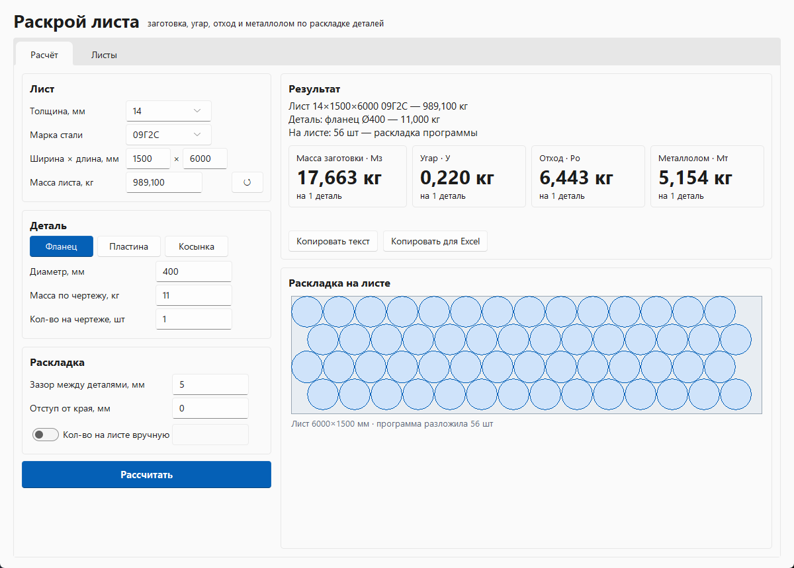

# Раскрой листа

Программа для расчёта **массы заготовки, угара, отхода и металлолома** при вырезке деталей из стального листа.

Вводишь лист (толщина, марка стали), деталь (фланец, пластина, косынка или **любая деталь из DXF**,
например нарисованная в Компасе) и её массу по чертежу. Программа раскладывает детали на листе,
считает, сколько их поместится, и выдаёт результат, который можно скопировать в Excel.



---

## Содержание

- [Быстрый старт](#быстрый-старт)
- [Как пользоваться](#как-пользоваться)
- [Деталь из DXF (Компас)](#деталь-из-dxf-компас)
- [Формулы расчёта](#формулы-расчёта)
- [Массы листов](#массы-листов)
- [Как программа раскладывает детали](#как-программа-раскладывает-детали)
- [Сравнение с ПроНестом](#сравнение-с-пронестом)
- [Пример расчёта](#пример-расчёта)
- [Запуск из исходников и сборка .exe](#запуск-из-исходников-и-сборка-exe)
- [Устройство проекта](#устройство-проекта)
- [Ограничения](#ограничения)

---

## Быстрый старт

1. Скачай `Raskroy.exe` из раздела **Releases** этого репозитория.
2. Запусти двойным кликом — устанавливать ничего не нужно.
3. Если Windows покажет «Windows защитила ваш компьютер», нажми **Подробнее → Выполнить в любом случае**.
   Это обычное предупреждение для программ без цифровой подписи.

Работает на Windows 10 и 11.

---

## Как пользоваться

Окно разделено на две части: слева вводишь данные, справа — результат и картинка раскладки.

### 1. Лист

| Поле | Что вводить |
|---|---|
| **Толщина, мм** | Выбрать из стандартного ряда (3 … 40) или вписать свою |
| **Марка стали** | 09Г2С или Ст3пс |
| **Ширина × длина, мм** | По умолчанию 1500 × 6000. Меняется, если лист другого размера |
| **Масса листа, кг** | Считается сама. Можно вписать свою цифру — кнопка **↺** вернёт расчётную |

Масса пересчитывается автоматически при смене толщины, марки или размера листа.
Если масса вписана вручную, в результате это будет отмечено: *«вручную, по формуле …»*.

### 2. Деталь

Выбери тип детали кнопками **Фланец / Пластина / Косынка / DXF** и заполни размеры:

| Тип | Размеры | Примечание |
|---|---|---|
| **Фланец** | Диаметр | Отверстия не учитываются — масса детали берётся с чертежа |
| **Пластина** | Длина и ширина | Прямоугольник, может поворачиваться на 90° |
| **Косынка** | Катет 1, катет 2, срез углов | Прямоугольный треугольник, срезаны все 3 угла (обычно 5, 10, 15 или 20 мм) |
| **DXF** | Файл с контуром детали | Любая форма — см. [Деталь из DXF](#деталь-из-dxf-компас) |

Ниже:

- **Масса по чертежу, кг** — масса готовой детали (Мд).
- **Кол-во на чертеже, шт** — сколько таких деталей в изделии. Результат покажется и на 1 деталь, и на всё количество.

### 3. Раскладка

| Поле | По умолчанию | Что значит |
|---|---|---|
| **Зазор между деталями, мм** | 5 | Расстояние между соседними деталями |
| **Отступ от края, мм** | 0 | Сколько отступить от края листа |
| **Кол-во на листе вручную** | выключено | Включи, чтобы считать по своему количеству (например, из ПроНеста) |

Если переключатель **«Кол-во на листе вручную»** включён, программа считает по введённой цифре,
а в результате пишет, сколько разложила бы сама: *«836 шт — вручную (программа разложила 1468)»*.

### 4. Рассчитать

Нажми **Рассчитать** или клавишу **Enter**.

Справа появятся:

- лист, деталь и количество деталей на листе;
- четыре плитки — **Мз, У, Ро, Мт** на 1 деталь (и на количество по чертежу, если оно больше 1);
- картинка раскладки деталей на листе.

Если отход получился **отрицательным**, значения подсвечиваются красным и появляется предупреждение.
Обычно это значит, что масса детали не соответствует толщине листа или количество на листе завышено.

### 5. Копирование результата

- **Копировать текст** — весь результат текстом, например для мессенджера.
- **Копировать для Excel** — строка с заголовками через табуляцию. Встань в ячейку Excel и нажми **Ctrl+V** —
  значения разложатся по колонкам:

  `Лист | Масса листа | Деталь | Мд | Кол-во на листе | Мз | У | Ро | Мт | Кол-во на чертеже | Ро × кол-во | Мт × кол-во`

### Вкладка «Листы»

Справочник масс всех листов 1500 × 6000 по стандартному ряду толщин для обеих марок.
Кнопка **Копировать таблицу для Excel** копирует её целиком.

---

## Деталь из DXF (Компас)

Для деталей нестандартной формы: нарисуй деталь в Компасе (или любой CAD) и сохрани в DXF.

**Как сохранить в Компасе:** открой фрагмент или чертёж с деталью → **Файл → Сохранить как** →
тип файла **DXF**. Лучше сохранять **фрагмент** с одной деталью в масштабе 1:1.

**В программе:**

1. Нажми кнопку **DXF** в карточке «Деталь», затем **Открыть DXF…** и выбери файл.
2. Программа сама найдёт контур детали и отверстия. Если в файле несколько контуров
   (например, сохранён чертёж с рамкой), выбери нужный в списке **Контур** — в нём видны габариты
   и количество отверстий каждого.
3. Ниже показываются **площадь** детали (за вычетом отверстий) и **масса** для выбранной толщины и марки
   (площадь × толщина × плотность).
4. Заполни два поля под контуром — они нужны для формул так же, как у фланца и косынки:
   - **Масса по чертежу, кг** — масса готовой детали (Мд). От неё считаются угар (2 % от Мд)
     и отход (Мз − Мд − У). Нажми **→ в массу детали**, чтобы подставить массу, посчитанную по контуру,
     или впиши массу с чертежа.
     > ⚠ Само поле при загрузке DXF **не меняется** — в нём остаётся прежнее значение
     > (например, 11 кг от примера с фланцем). Если не нажать кнопку и не вписать массу,
     > угар и отход посчитаются по неправильной массе. После смены толщины или марки нажми кнопку ещё раз.
   - **Кол-во на чертеже, шт** — сколько таких деталей в изделии. Результат покажется на 1 деталь
     и на это количество. Если деталь одна — оставь 1.
5. Нажми **Рассчитать**. Сложная деталь считается от долей секунды до ~30 секунд —
   в это время в результате написано «Считаю раскладку…».

**Что программа читает из DXF:** отрезки, дуги, окружности, эллипсы, сплайны и полилинии
(в том числе со скруглениями и внутри блоков). Размеры, тексты, штриховки и осевые/штриховые линии
пропускаются. Отрезки, нарисованные по отдельности, сшиваются в контур, даже если концы не сходятся
до 0,05 мм; дубли линий отбрасываются. Единицы файла (мм, см, м, дюймы) учитываются автоматически.

**Если что-то не так:**

| Сообщение / проблема | Что делать |
|---|---|
| «Не найдено ни одного замкнутого контура» | Контур детали разорван — замкни его в Компасе (концы линий должны сходиться) |
| «Пропущено незамкнутых линий: N» | Обычно это осевые или вспомогательные линии — не страшно. Если пропала часть детали — проверь стыки в Компасе |
| В списке выбран не тот контур (рамка, штамп) | Выбери нужный контур в списке **Контур** |
| Габарит в списке **Контур** не совпадает с размерами детали | Проверь другие контуры в списке. Если подходящего нет — контур собрался неправильно (часто вместе с «Пропущено незамкнутых линий»): проверь стыки линий в Компасе или пришли файл разработчику |
| Отход получился красным (отрицательным) | В поле «Масса по чертежу» осталась чужая масса — нажми **→ в массу детали** или впиши правильную |
| Размеры в 10 или 1000 раз больше/меньше | В файле неправильно указаны единицы — сохрани DXF заново в миллиметрах |

Для проверки в папке [`samples`](samples) лежат готовые DXF: фланец с отверстиями и осевыми,
пластина со скруглениями, Г-образный кронштейн, фигурная деталь из сплайна, деталь в блоке
в сантиметрах, деталь внутри рамки чертежа и «грязный» контур с незамкнутыми стыками.

---

## Формулы расчёта

| Обозначение | Что это | Формула |
|---|---|---|
| **Мл** | Масса листа | ширина × длина × толщина × плотность |
| **N** | Количество деталей на листе | по раскладке (или вручную) |
| **Мд** | Масса детали | с чертежа |
| **Мз** | Масса заготовки | **Мз = Мл / N** |
| **У** | Угар (2 % от массы детали) | **У = 0,02 × Мд** |
| **Ро** | Отход | **Ро = Мз − Мд − У** |
| **Мт** | Металлолом (80 % от отхода) | **Мт = 0,8 × Ро** |

На количество по чертежу все значения просто умножаются на это количество.

---

## Массы листов

Масса листа считается так же, как в калькуляторе
[service-online.su/text/calc](https://service-online.su/text/calc/) — объём листа × плотность марки,
с точностью до грамма.

| Марка | Плотность, кг/м³ |
|---|---|
| 09Г2С | 7850 |
| Ст3пс | 7800 |

Листы 1500 × 6000 мм:

| Толщина, мм | 09Г2С, кг | Ст3пс, кг |
|---|---|---|
| 3 | 211,950 | 210,600 |
| 4 | 282,600 | 280,800 |
| 5 | 353,250 | 351,000 |
| 6 | 423,900 | 421,200 |
| 8 | 565,200 | 561,600 |
| 10 | 706,500 | 702,000 |
| 12 | 847,800 | 842,400 |
| 14 | 989,100 | 982,800 |
| 16 | 1130,400 | 1123,200 |
| 18 | 1271,700 | 1263,600 |
| 20 | 1413,000 | 1404,000 |
| 22 | 1554,300 | 1544,400 |
| 25 | 1766,250 | 1755,000 |
| 28 | 1978,200 | 1965,600 |
| 30 | 2119,500 | 2106,000 |
| 32 | 2260,800 | 2246,400 |
| 36 | 2543,400 | 2527,200 |
| 40 | 2826,000 | 2808,000 |

> В старой Excel-таблице часть масс посчитана с другой плотностью (например, лист 14 мм — 995,4 кг вместо 989,1),
> поэтому цифры могут немного отличаться. Если нужна масса из своей таблицы — впиши её в поле **Масса листа**.

---

## Как программа раскладывает детали

Задача — уместить на лист **максимум** деталей с заданным зазором.

**Фланцы (круги)** — укладываются рядами «в шахматку»: каждый второй ряд сдвинут, чтобы круги
заходили в промежутки предыдущего ряда. Программа пробует ряды вдоль и поперёк листа и разные сдвиги.

**Пластины (прямоугольники)** — укладываются сеткой, с поворотом на 90° и без.

**Косынки (треугольники)** — укладываются парами «вверх-вниз»: гипотенуза к гипотенузе
с зазором между ними, полосами вдоль или поперёк листа. Срезанные углы на количество не влияют,
но показываются на картинке.

**Детали из DXF (любая форма)** — раскладываются «плиткой», ведь на лист кладутся одинаковые детали:

1. Контур детали «раздувается» на половину зазора — раздутые копии могут касаться,
   а между настоящими деталями остаётся ровно заданный зазор (или на сотые доли мм больше, не меньше).
2. Перебираются углы поворота (любой угол) и для каждого — одиночная деталь и **пара**
   «деталь + её копия, повёрнутая на 180°». Пары сцепляются: треугольники складываются в прямоугольник,
   Г-образные детали — «ёлочкой».
3. Для каждого варианта считается самая плотная решётка (шаг вдоль ряда и сдвиг следующего ряда),
   по краям рядов докладываются одиночные детали из пары.
4. Из лучших вариантов выбирается тот, который даёт больше всего деталей именно на этом листе.

Для проверки этот способ прогнан на простых формах, где ответ известен: прямоугольники и полосы
дают то же количество, что точные формулы, круги и треугольники — то же или на 1 % меньше
(Ø260: 132 против 133, косынка 130 × 80: 1454 против 1468). Для стандартных деталей программа
всё равно использует точные формулы — раскрой по контуру нужен для нестандартных.
Г-образная деталь 200 × 150 ложится 558 шт против 279 при раскладке по габариту.

**Дозаполнение остатков.** Для любой детали программа дополнительно перебирает, как разрезать лист
на две зоны с разной раскладкой (например, основная часть рядами вдоль, остаток — поперёк),
и берёт вариант, где деталей больше.

Расчёт занимает доли секунды. Картинка внизу окна показывает, как именно легли детали —
по ней удобно сверить раскладку с ПроНестом.

---

## Сравнение с ПроНестом

Для проверки взяты количества из ПроНеста (лист 1500 × 6000), зазор в программе 5 мм.

**Фланцы** — результат близок к ПроНесту: из 20 случаев 8 совпадают точно,
остальные отличаются на 1–5 шт (обычно программа кладёт чуть больше).

| Ø, мм | ПроНест | Программа |
|---|---|---|
| 400 | 56 | 56 |
| 420 | 48 | 48 |
| 500 | 33 | 33 |
| 580 | 22 | 22 |
| 600 | 20 | 22 |
| 350 | 64 | 69 |

**Косынки** — программа кладёт заметно больше, чем ПроНест (на 30–100 %),
и это практически предел для укладки «вверх-вниз» с зазором 5 мм:

| Косынка | ПроНест | Программа |
|---|---|---|
| 130 × 80 | 836 | 1468 |
| 120 × 90 | 868 | 1422 |
| 100 × 100 | 1128 | 1516 |
| 400 × 150 | 196 | 272 |

Скорее всего, ПроНест оставляет место под заход/выход реза или работает с бо́льшим зазором.
Если на практике столько косынок с листа не выходит — **увеличь зазор** или
**включи «Кол-во на листе вручную»** и введи число из ПроНеста.

Сверку можно повторить скриптом:

```
python check_pronest.py        # зазор 5 мм
python check_pronest.py 10     # зазор 10 мм
```

---

## Пример расчёта

Фланец Ø400, масса по чертежу 11 кг, лист 14 × 1500 × 6000 09Г2С.

| Шаг | Значение |
|---|---|
| Масса листа | 989,100 кг |
| Фланцев на листе | 56 шт |
| Мз = 989,100 / 56 | **17,663 кг** |
| У = 0,02 × 11 | **0,220 кг** |
| Ро = 17,663 − 11 − 0,220 | **6,443 кг** |
| Мт = 0,8 × 6,443 | **5,154 кг** |

---

## Запуск из исходников и сборка .exe

Нужен **Python 3.10+** (при установке отметить «Add python.exe to PATH»).

```
pip install -r requirements.txt
python app.py
```

Или двойной клик по **`Запуск.bat`** — он сам поставит недостающий пакет и откроет программу без окна консоли.

Сборка одного `.exe` (≈ 34 МБ, Python и библиотеки внутри):

```
pip install pyinstaller
python -m PyInstaller --onefile --windowed --name Raskroy --noconfirm ^
    --distpath dist --workpath build --specpath build app.py
```

Готовый файл — `dist\Raskroy.exe`. После любых правок в коде его нужно пересобрать.

---

## Устройство проекта

| Файл | Что внутри |
|---|---|
| `app.py` | Окно программы (tkinter + тема Sun Valley) |
| `sheets.py` | Справочник: размеры листа, ряд толщин, плотности марок, масса листа |
| `nesting.py` | Раскладка деталей на листе: фланцы, пластины, косынки; дозаполнение остатков |
| `dxf_import.py` | Чтение DXF: сшивка контуров, отверстия, блоки, единицы, отсев осевых и размеров |
| `free_nesting.py` | Раскрой детали любой формы (контур из DXF) |
| `calc.py` | Формулы: Мз, угар, отход, металлолом |
| `check_pronest.py` | Сверка раскладки с количествами из ПроНеста + проверка, что детали не перекрываются |
| `test_free.py` | Раскрой по контуру против точных формул + проверка зазоров и границ листа |
| `test_dxf.py` | Чтение образцов DXF: габариты, отверстия, площади |
| `samples/` | Образцы DXF и скрипт `make_samples.py`, который их создаёт |
| `Запуск.bat` | Запуск из исходников двойным кликом |
| `requirements.txt` | Зависимости: тема `sv-ttk`, `ezdxf` (DXF), `shapely` и `pyclipper` (геометрия) |

Чтобы добавить марку стали — допиши её с плотностью в `GRADES` в `sheets.py`.
Чтобы поменять ряд толщин — список `THICKNESSES` там же.
Процент угара и доля металлолома — константы `BURN_RATE` и `SCRAP_RATE` в `calc.py`.

---

## Ограничения

- Детали раскладываются регулярными рядами («плиткой»), а не по одной, как в ПроНесте.
  Для одинаковых деталей это обычно не хуже, но на краях листа ПроНест иногда докладывает 1–2 детали больше.
- Заход/выход реза отдельно не учитывается — закладывается через зазор между деталями.
- На одном листе раскладываются детали одного вида (без смешивания разных деталей).
- В отверстия крупных деталей мелкие не вкладываются.
- Встроенного редактора чертежей нет — деталь сложной формы рисуется в Компасе и загружается через DXF.
- Реальные выгрузки из Компаса пока проверены только на образцах, сделанных по их типичному виду —
  если какой-то файл не прочитается, пришли его, поправлю.
